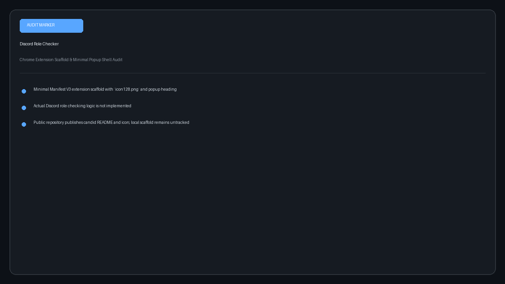

# Discord Role Checker · Extension Scaffold

> **Manifest V3 Chrome extension scaffold and minimal popup interface audit.**

*Click the preview card above to watch the scaffold walkthrough.*

---

## Repository Status

This repository tracks a minimal Manifest V3 Chrome extension scaffold and its official icon (`icon128.png`). 

> [!NOTE]
> **Implementation Scope:** The popup shell and manifest permissions (`storage`, `activeTab`, `scripting`) are scaffolded, but Discord API role lookup logic is not implemented. The repository honestly sets expectations as a work-in-progress prototype.

## What Is Included

- **Extension Icon:** Tracked at `icon128.png`.
- **Scaffold Architecture:** MV3 background service worker and popup layout definitions.
- **Documentation:** Candid status notes explaining current project boundaries.

## Media

- **Scaffold Card:** `media/overview.png`
- **Walkthrough Video:** `media/walkthrough.mp4`
